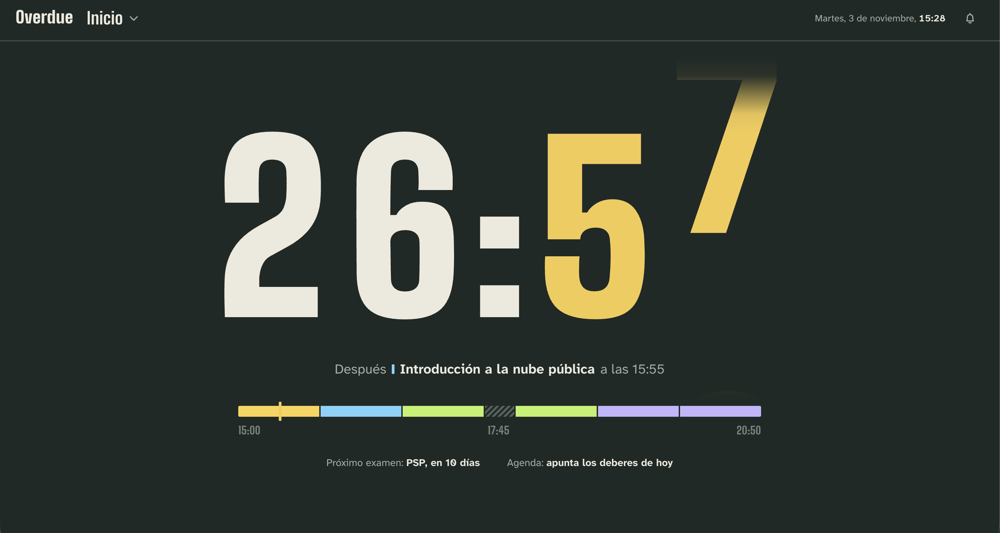
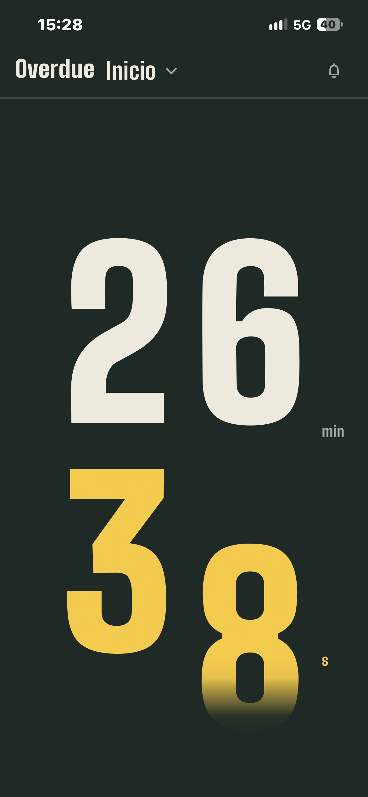
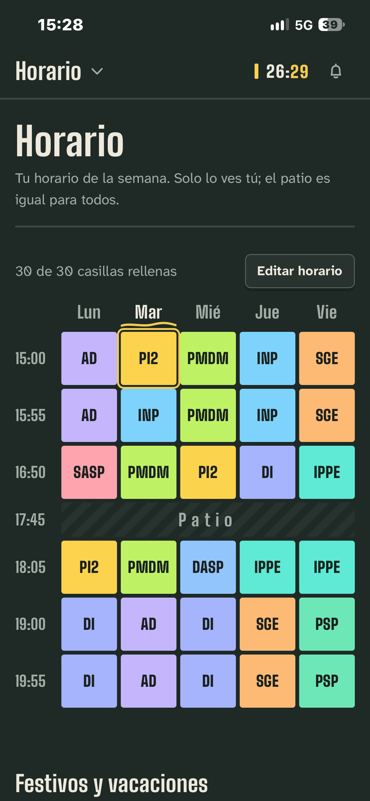
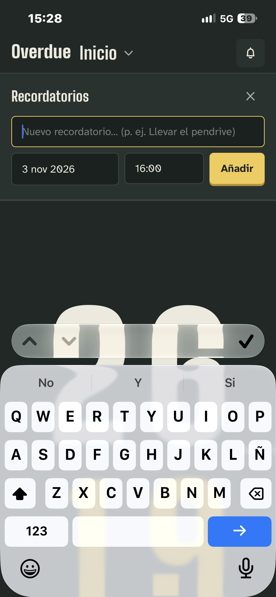
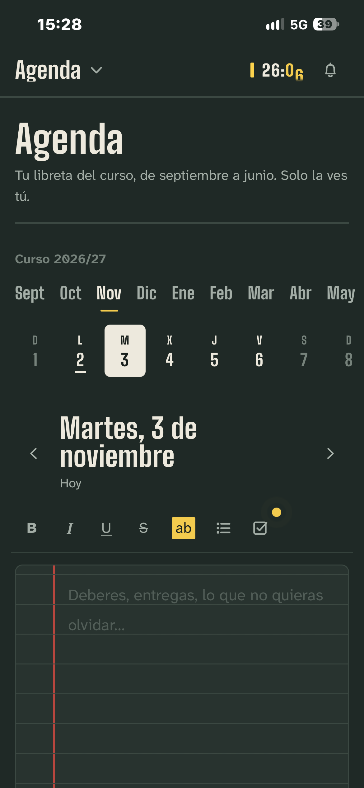
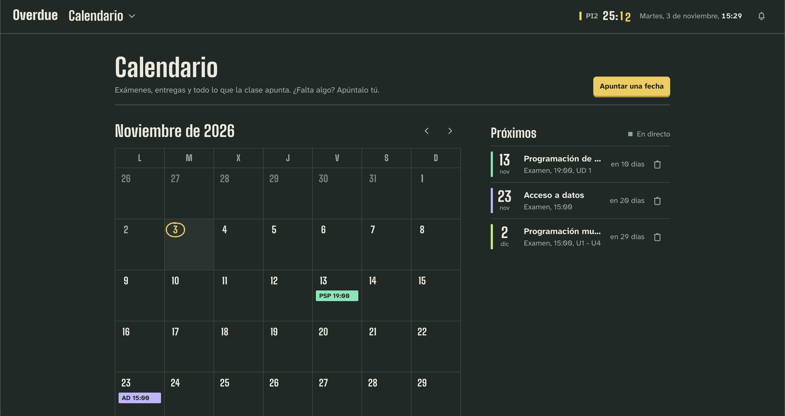
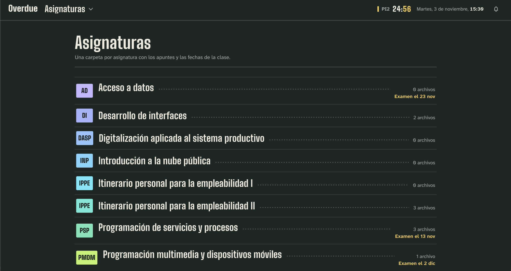
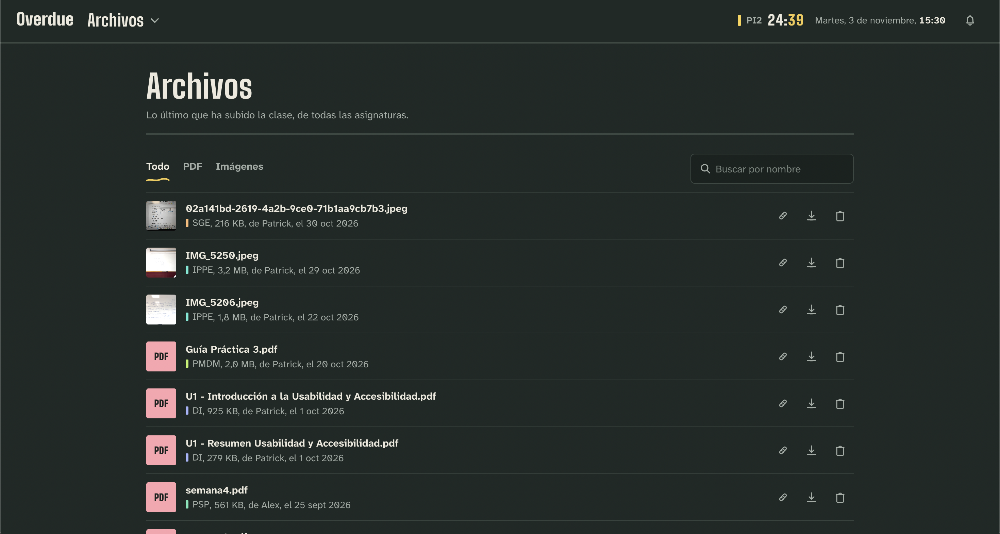
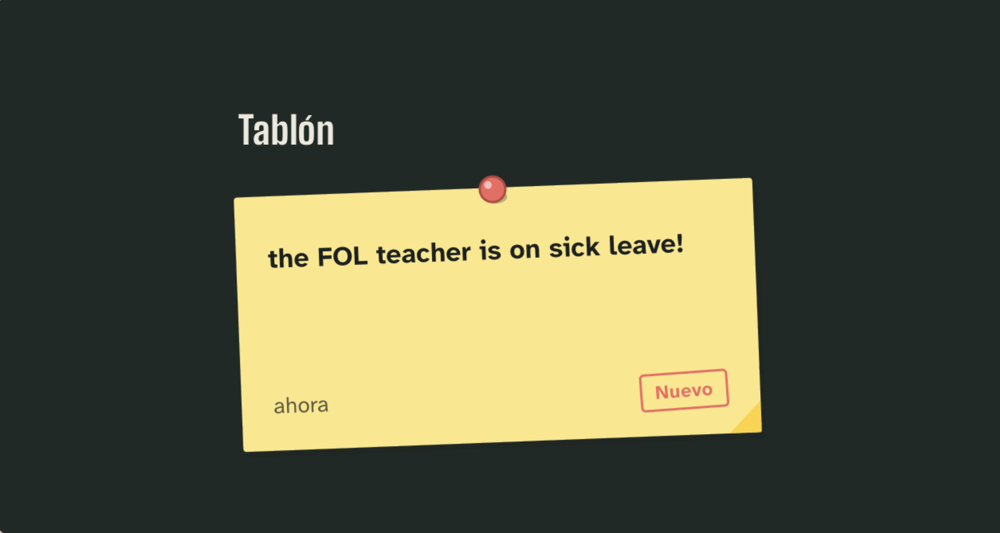
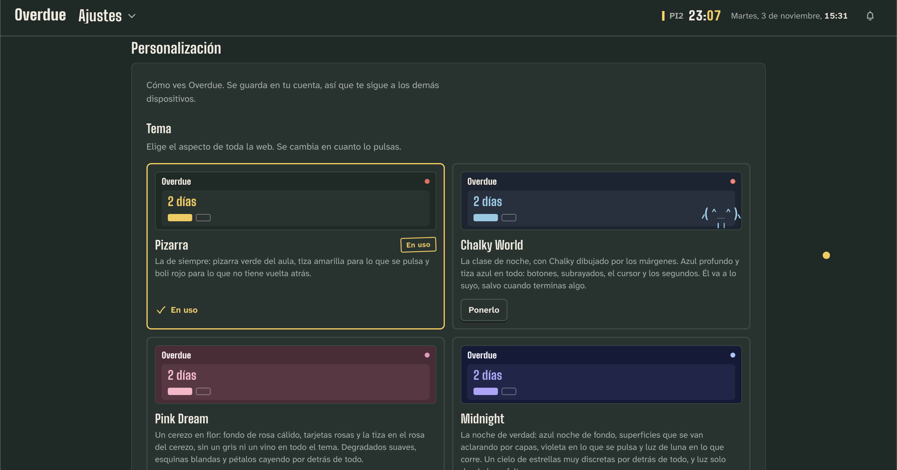

# Overdue

**Your school life. One single place.**

Timetable, exams, subjects, notes and reminders for your whole class, 
in a fast, minimal web app built for the phone first.

 

**Built together by [@alexcalatyd](https://github.com/alexcalatyd) and [@Alguiennn](https://github.com/Alguiennn)**

[Classes](#-classes) ·
[Features](#-features) ·
[Privacy](#-privacy-and-permissions) ·
[Design](#-design) ·
[Roadmap](#️-roadmap)

 

> This repository is a showcase. The source code is not published here.

---

## ✦ What is Overdue?

Overdue is a collaborative web platform for students. It brings together in one place everything that is normally scattered across apps, group chats and random folders.

The moment you open it, you know:

> **What do I have now?** · **How long is left?** · **What comes next?** 
> **When is the next exam?** · **Where are the notes?** · **Anything to remember?**

Without opening five different apps.

It started as the website of a single class and today it is a platform: **anyone creates their own and shares a code to get in**. What you put in a class stays in that class. Personal things stay personal — nobody else sees them.

---

## 🚪 Classes

A class is where the shared content lives. Nothing is ever mixed between one class and another.

- **Whoever creates it runs it:** sets the periods, the subjects, the timetable and the noticeboard, and can take down anything posted inside.
- **You join with a code**, handed out by whoever runs the class. No lists to request, no waiting.
- **You can be in several** and switch between them from the menu; creating is capped at two per person.
- **The first time** there is a four-step welcome: install the app, turn on notifications, draw your timetable and how the class works. Skippable from the very first screen.
- **If another Overdue class is really the same physical classroom** (several groups sharing a room, each with their own Overdue), its setup — periods, subjects, class timetable and teachers — can be pulled in with a code instead of building it from scratch.

---

## ✨ Features

| | Feature | What it does | Visibility |
|:-:|---|---|:-:|
| 🕐 | [**Timetable**](#-smart-timetable) | Live countdown of the current period and the next one | 🔒 Private |
| 🔔 | [**Reminders**](#-reminders) | Personal reminders with date and time | 🔒 Private |
| 📓 | [**Planner**](#-planner) | A notebook page for every day of the school year | 🔒 Private |
| 📅 | [**Exams & deadlines**](#-exams-and-deadlines) | A calendar shared by the whole class | 👥 Class |
| 📚 | [**Subjects**](#-subjects-and-teachers) | A space per subject, with who teaches it | 👥 Class |
| 📁 | [**Notes & files**](#-notes-and-files) | Shared material, up to 150 MB per file | 👥 Class |
| 📌 | [**Noticeboard**](#-noticeboard) | Class announcements as sticky notes | 👥 Class |
| 📲 | [**Push notifications**](#-notifications-on-your-phone) | Alerts for exams, files and the noticeboard | 🔒 Private |
| 🎨 | [**Themes & languages**](#-design) | Four themes and 15 languages, picked in Settings | 🔒 Private |

### 🕐 Smart timetable

Everyone sets their own timetable — or copies the class one with a single tap — and Overdue crosses it with the current time to turn the home screen into a countdown.

- Rolls from one period to the next on its own.
- Knows about breaks and free periods.
- Leave the home screen and the countdown doesn't disappear: it tucks into the top bar and keeps running.
- Classes whose week isn't always the same can set the timetable **by date**, bank holidays included.
- Every user has their own timetable, and nobody can see anyone else's.

### 🔔 Reminders

Personal reminders, built into the home screen instead of becoming yet another section.

Once the time passes, the reminder stops showing as pending. Everyone creates, edits and deletes their own, and they are never shared.

### 📓 Planner

A personal notebook with one page per day of the school year, September to June, for homework and notes. Each page also shows that day's exams. Like the timetable and the reminders, only its owner can see it.

### 📅 Exams and deadlines

A calendar shared by the whole class, with a countdown to whatever is coming next. Exams and deadlines are announced differently, so they look different. The class itself adds them, and whoever runs the class fixes or removes what shouldn't be there.

### 📚 Subjects and teachers

Every subject is a shared space that gathers its material and tells you **who teaches it and their contact email**. The list isn't fixed: whoever runs the class builds it and extends it whenever needed.

### 📁 Notes and files

Each subject works as a small collaborative repository: 📄 PDFs, 📝 documents, 🖼️ images, 📃 text files and any other class material.

- **Up to 150 MB per file**, uploaded in chunks: a bad connection no longer kills the whole upload.
- **Previewed inside Overdue**, nothing to download: photos, PDFs (with pdf.js) and documents.
- **Photos and scans are compressed in the browser** before being uploaded.
- **Every file gets its own page** and a link to share it.
- Each post takes a comment and reactions, and keeps who uploaded it and when.
- Files don't expire: they stay until someone takes them down.

### 📌 Noticeboard

Class news (*"the FOL teacher is on sick leave!"*) shows up as sticky notes pinned to a board, three at a time at most. Pinned by whoever runs the class.

### 📲 Notifications on your phone

Push notifications when an exam is set, a file is uploaded or something new is pinned to the board. They are picked one by one in Settings, every device decides whether it wants them, and they can be turned off at any time. Overdue also installs as an app.

### 🆕 What's new

When something changes, Overdue says so: a notice on your way in with everything new since last time, and the full version history at `/novedades`.

---

## 🔐 Privacy and permissions

| Information | Visibility | Who manages it |
|---|:-:|---|
| 🕐 Timetable | 🔒 Private | The user |
| 🔔 Reminders | 🔒 Private | The user |
| 📓 Planner | 🔒 Private | The user |
| 🎨 Theme and language | 🔒 Private | The user |
| 📅 Exams & deadlines | 👥 Class | The class + whoever runs it |
| 📚 Subjects | 👥 Class | Whoever runs the class |
| 📁 Files | 👥 Class | The class + whoever runs it |
| 📌 Noticeboard | 👥 Class | Whoever runs the class |

> [!NOTE]
> Permissions are not a matter of hiding buttons in the interface. Keeping classes apart doesn't depend on the code remembering to filter either: the database enforces it with row-level policies, so every user only sees and changes what is theirs.

**Accounts:** signing up means confirming your email, and anyone who forgets their password recovers it by email without having to ask a human. You must be **14 or older**. The [legal notice](https://overdue.one/legal) and the [privacy policy](https://overdue.one/privacidad) can be read without an account, from the footer of any page; they're accepted on sign-up and, if they change substantially, Overdue says so and they're accepted again from Settings. No advertising, analytics or third-party tracking cookies — which is why there's no cookie banner.

---

## 🎨 Design

> **The information that matters should show up before the interface does.**

The starting look is a **classroom blackboard**: dark green background, chalk text, yellow chalk for what matters and red pen for what's dangerous.

- **Four themes**, picked in Settings with one click and carried over to your other devices: **Pizarra**, **Chalky World**, **Pink Dream** and **Midnight**.
- **Everyone decides how much decoration they want**, whether the tones follow the time of day, and whether they'd rather have no animations at all.
- **15 languages**, detected from the device and switchable in Settings, right-to-left Arabic included.
- **Mobile first for real.** The phone version isn't the desktop one squeezed. It answers what you have now, how long is left and what's next; everything else is one tap away.
- **On desktop**, the space is used to show the current period, the next one, the reminders and the next exam at once, with the same visual identity.
- **No noise:** no crowded panels, no twenty buttons to do one thing, no menus for the sake of menus. Careful loading and empty states, subtle animation and accessibility.

<table>
<tr>
<td><b>Typefaces</b></td>
<td><a href="https://fonts.google.com/specimen/Big+Shoulders">Big Shoulders</a> for figures and headings · <a href="https://fonts.google.com/specimen/Atkinson+Hyperlegible+Next">Atkinson Hyperlegible Next</a> for body text</td>
</tr>
<tr>
<td><b>Colours (Pizarra)</b></td>
<td>Board <code>#1f2926</code> · Chalk <code>#ede9dd</code> · Yellow chalk <code>#f3cb4e</code> · Red pen <code>#f2685e</code></td>
</tr>
</table>

---

## 🧱 Built with

**Next.js 16** (App Router, Server Actions) · **React 19** · **TypeScript** · **Tailwind CSS v4** · **Supabase** (Postgres with RLS, Auth and Storage) · **Web Push** · **pdf.js** · **Motion**

---

## 🗺️ Roadmap

- [x] Accounts and authentication, with email confirmation and password recovery
- [x] Personal timetables with a live countdown
- [x] Personal reminders
- [x] Planner
- [x] Subjects and teachers
- [x] Exam and deadline calendar
- [x] File sharing (150 MB, preview and a page per file)
- [x] Noticeboard
- [x] Classes: anyone creates one, you join with a code
- [x] Class timetable, weekly or by date
- [x] Copying one class's setup into another
- [x] Push notifications and install as an app
- [x] Legal notice and privacy policy
- [x] 15 languages
- [x] Themes and personalisation
- [x] What's new and version history
- [ ] More mobile experience work
- [ ] Performance and scalability

> Overdue started as a private platform for classmates and grows as it gets used in real situations, so the roadmap can change.

---

## 👥 Authors

Overdue is made by two people, together:

<table>
<tr>
<td align="center" width="50%">
<a href="https://github.com/alexcalatyd"> <b>@alexcalatyd</b></a>
</td>
<td align="center" width="50%">
<a href="https://github.com/Alguiennn"> <b>@Alguiennn</b></a>
</td>
</tr>
</table>

---

## 📄 Licence

The project has no licence yet, so all rights are reserved by its authors. This repository only showcases it — the source code is not published here.

---

**Fewer apps. Less chaos. More Overdue.**

Made by students, for students.

